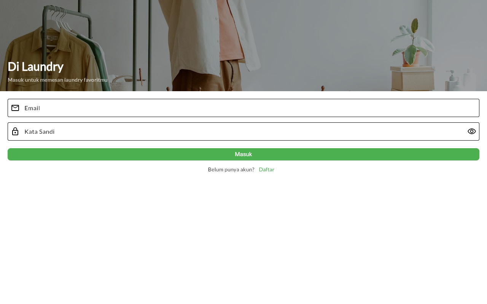

# Di Laundry - Frontend Flutter

Aplikasi laundry bernama Di Laundry yang dibangun dengan Flutter. Aplikasi ini adalah sisi frontend dari backend [laravel-backend-laundry](https://github.com/bintangyudhis/laravel-backend-laundry) dan berkomunikasi melalui REST API dengan autentikasi token Laravel Sanctum. Pengguna dapat melihat promo dan toko laundry, membuat pesanan, melacak status pesanannya, dan mengklaim pesanan yang dibuatkan oleh toko.

## Fitur

- Registrasi dan login pengguna, sesi tersimpan otomatis sehingga pengguna tetap masuk saat aplikasi dibuka lagi
- Token akses disimpan di penyimpanan aman perangkat dengan flutter_secure_storage
- Beranda berisi promo terbaru, rekomendasi toko dengan rating tertinggi, dan daftar semua toko laundry
- Pencarian toko berdasarkan nama kota
- Detail toko dengan harga per kilogram, ketersediaan jemput dan antar, serta paket promo milik toko itu
- Buat pesanan dengan pilihan paket reguler atau promo, berat cucian, jadwal penjemputan, alamat jemput dan antar, dan catatan isi cucian. Total harga dihitung otomatis dari harga per kilogram dan berat
- Pesanan saya dengan saringan status mengikuti kategori backend, yaitu Pickup, Queue, Process, Washing, Dried, Ironed, Done, dan Delivery
- Detail pesanan yang menampilkan kode klaim, rincian layanan, dan total bayar
- Klaim laundry memakai ID pesanan dan kode klaim dari toko
- Halaman rekomendasi berisi toko dengan rating tertinggi
- Profil pengguna dengan data akun dan tombol keluar

## Teknologi

- Flutter 3 dan Dart 3
- http untuk permintaan REST API
- flutter_secure_storage untuk menyimpan token
- shared_preferences untuk menyimpan data profil pengguna
- google_fonts untuk huruf Lato
- intl untuk format harga rupiah dan tanggal

## Cara Instalasi

Prasyarat:

- Flutter SDK versi 3.10 atau lebih baru, periksa dengan `flutter --version`
- Backend laravel-backend-laundry sudah berjalan, lihat bagian Konfigurasi Alamat API di bawah

Langkah instalasi:

```bash
git clone https://github.com/bintangyudhis/flutter-frontend-laundry.git
cd flutter-frontend-laundry
flutter pub get
```

Atur alamat API di berkas `lib/config/app_constants.dart` pada nilai `_host` agar menunjuk ke server backend, contohnya `http://192.168.1.10:8000` untuk perangkat fisik dalam satu jaringan WiFi, atau `http://10.0.2.2:8000` untuk emulator Android. Penjelasan lengkap ada di bagian Konfigurasi Alamat API.

Jalankan aplikasi:

```bash
flutter run
```

Untuk menjalankan versi web di peramban:

```bash
flutter run -d chrome
```

Periksa kesehatan kode kapan saja dengan:

```bash
flutter analyze
```

## Konfigurasi Alamat API

Semua alamat API diatur di satu tempat, yaitu `lib/config/app_constants.dart`:

- `_host` adalah alamat dasar server backend dan satu-satunya nilai yang perlu diganti mengikuti lingkungan masing-masing
- `baseUrl` adalah `_host` ditambah `/api`, dipakai oleh semua datasource
- `baseImageUrl` adalah `_host` ditambah `/storage/images/`, dipakai untuk memuat gambar toko dan promo

Nilai bawaan `_host` adalah `http://192.168.18.48:8000`, alamat server pengembangan di jaringan lokal pemilik proyek. Ganti sebelum menjalankan aplikasi di jaringan lain. Bila backend belum menyajikan gambar dari folder storage, kartu toko dan promo otomatis menampilkan gambar cadangan dari aset aplikasi.

## Struktur Folder

```text
lib/
  config/       Konfigurasi aplikasi, sesi, format, dan penanganan galat
  datasources/  Lapisan akses API untuk auth, promo, toko, dan laundry
  models/       Model data pengguna, toko, promo, dan pesanan
  pages/        Halaman aplikasi, termasuk auth dan halaman utama dasbor
  widgets/      Widget bersama seperti kartu toko, kartu promo, dan chip status
  main.dart     Titik masuk aplikasi dan gerbang pemeriksaan sesi
```

## Endpoint yang Dipakai

| Method | Endpoint | Keterangan |
| --- | --- | --- |
| POST | `/api/register` | Registrasi pengguna baru |
| POST | `/api/login` | Login dan menerima token |
| GET | `/api/promo` | Semua promo, dipakai untuk paket promo di detail toko |
| GET | `/api/promo/limit` | Lima promo terbaru untuk beranda |
| GET | `/api/shop` | Semua toko laundry |
| GET | `/api/shop/recommendation/limit` | Toko dengan rating tertinggi |
| GET | `/api/shop/search/city/{name}` | Cari toko berdasarkan kota |
| GET | `/api/laundry/user/{id}` | Pesanan milik pengguna yang masuk |
| POST | `/api/laundry` | Buat pesanan laundry baru |
| POST | `/api/laundry/claim` | Klaim pesanan dengan kode klaim |

Semua endpoint kecuali register, login, daftar promo, dan daftar toko memerlukan header `Authorization: Bearer <token>`.

## Alur Penggunaan

1. Daftar akun baru atau masuk dengan akun yang sudah ada.
2. Di beranda, pilih toko dari daftar, hasil pencarian kota, atau rekomendasi.
3. Di detail toko, tekan Pesan Sekarang, pilih paket, isi berat dan layanan tambahan, lalu kirim pesanan. Kode klaim muncul setelah pesanan dibuat.
4. Pantau pesanan di tab Pesanan dan buka detailnya untuk melihat kode klaim dan status terakhir.
5. Bila toko membuatkan pesanan atas namamu, hubungkan pesanan itu ke akunmu lewat tab Klaim dengan ID pesanan dan kode klaim.

## Tangkapan Layar

Halaman masuk aplikasi Di Laundry pada versi web.



## Lisensi

Proyek ini memakai lisensi MIT. Lihat berkas [LICENSE](LICENSE) untuk teks lengkapnya.
